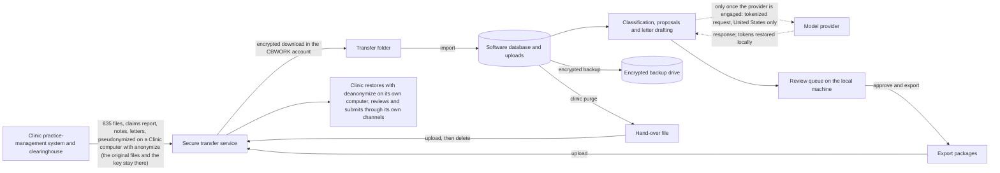

# HIPAA Security Risk Analysis

| | |
|---|---|
| Organization | Betz Technology Providers ("BTP") |
| Covered entity served | |
| Prepared by (Security Official) | Connor Betz |
| Date of analysis | |
| Version | 1.0 |
| Next scheduled review | |

## 1. Purpose and Method

This document is BTP's risk analysis under 45 C.F.R. § 164.308(a)(1)(ii)(A), which requires
"an accurate and thorough assessment of the potential risks and vulnerabilities to the confidentiality,
integrity, and availability of electronic protected health information held by the covered entity or
business associate," and the basis of its risk management under § 164.308(a)(1)(ii)(B).

The method follows NIST Special Publication 800-66 Revision 2, section 3.2: (1) prepare by identifying
where electronic protected health information (ePHI) is created, received, maintained and transmitted
(Sections 3 to 5); (2) identify reasonably anticipated threats; (3) identify vulnerabilities and
predisposing conditions; (4) determine likelihood; (5) determine impact; (6) determine the level of risk;
and (7) document the results (Sections 6 to 10). Rating scales follow NIST SP 800-30 Revision 1.

## 2. Regulatory Basis

This analysis applies the HIPAA Security Rule at 45 C.F.R. Part 164, Subpart C, as in effect on the date of
analysis. The amendments to the Security Rule proposed by HHS on January 6, 2025 (90 Fed. Reg. 898,
RIN 0945-AA22) had not been finalized on that date. Section 11 records where this program already meets
the principal proposals.

## 3. Scope

**In scope:** all ePHI of the covered entity served (the "Clinic") that BTP creates,
receives, maintains or transmits, wherever located: the workstation, the dedicated Windows account and its
files, Plumbline, BTP's denial-recovery software (the "Software"), and its database, BTP's side of the
secure transfer service, backups, the language model provider once engaged, communications, and paper.

**Out of scope:** the Clinic's own systems (practice-management system, clearinghouse and network), which
the Clinic's own risk analysis covers, and payers' systems.

**Workforce:** one person, Connor Betz, BTP's owner and Security Official. No other person has access to
ePHI.

## 4. System Description

- One workstation running Windows 11 Pro, located in the Security Official's home office, connected to the
  home network.
- Two Windows accounts. The daily account is used for all other work, including software development with
  development tools such as AI coding assistants, using synthetic data only; it never holds ePHI. The
  dedicated account CBWORK is a local, standard (non-administrator) account used only for work with the
  Clinic's data. All ePHI on the workstation resides in its private profile folder, outside OneDrive,
  including the Software's installation, data and export folders and the transfer folder. Development
  tools run only in the daily account and cannot read the CBWORK profile.
- The Software runs inside the CBWORK account from its own installation, with its own configuration file
  and data folder. It listens only on the local machine address (127.0.0.1, port 8000) and is used through
  the browser of the CBWORK account. Clinic reviewers working in person use it only in a CBWORK session
  that the Security Official opens and attends, with their own Software accounts.
- The language model provider (Anthropic, PBC, Claude API) is not engaged until a business associate
  agreement is in effect and the conditions in the Clinic's business associate agreement are met. Until
  then the Software sends no information to any model.

## 5. Asset and Data-Flow Inventory

| ID | Asset | ePHI held | Identifier or location | Protections |
|---|---|---|---|---|
| A1 | Workstation disk | All ePHI below while on the workstation | | BitLocker full-disk encryption; recovery key stored offline |
| A2 | Dedicated account CBWORK | Its profile folder holds all ePHI on the workstation, including the Software's installation, data and export folders and the transfer folder | `C:\Users\CBWORK` | Local standard account; strong password; private profile; no Microsoft account; outside OneDrive |
| A3 | Daily account | None | | Synthetic data only; source repository protected by ignore rules; secret scanning before each commit once installed (M23) |
| A4 | Software installation and configuration file | Session signing key; model API key once engaged | | Configuration file excluded from version control; placeholder signing keys refused at start |
| A5 | Software database | Patients, claims, lines, notes, letters, work items, proposals, outcomes, remittances, audit log | | Disk encryption; secure-delete setting on every connection; append-only, hash-chained audit log |
| A6 | Uploaded files | Files uploaded through the imports page | | Login and request-forgery checks before upload; 20 MB limit; deleted by the clinic purge |
| A7 | Export packages and hand-over file | Corrected claims with patient details, appeal letters, questions, audit excerpts; the hand-over file holds the Clinic's records at the end of the engagement | | Export packages created only for approved items and deleted by the clinic purge; the hand-over file is written by the purge and deleted by hand after delivery |
| A8 | Transfer folder | Files received from the Clinic before import | | Disk encryption; deleted at the end of the engagement |
| A9 | Browser profile of CBWORK | Cached review pages; downloaded export packages | | Disk encryption; cleared at the end of the engagement |
| A10 | Console output | Identifiers, counts and codes only | | Masking filter on every log handler |
| A11 | Secure transfer service | Files in transit and at rest on the service | | Encryption in transit and at rest; account with multi-factor authentication |
| A12 | Backup drive | Copies of the Software's data folder and configuration file (session signing key; model API key once engaged) | | BitLocker To Go; NTFS permissions limited to CBWORK; stored in a locked location under BTP's sole control, away from the workstation; removals logged |
| A13 | Model provider account (once engaged) | Tokenized requests and responses, retained under the provider's terms | | Business associate agreement; HIPAA-ready organization; single path to the model with redaction |
| A14 | Authenticator applications | Authentication secrets, no ePHI | | Phone screen lock |
| A15 | BitLocker recovery keys | Keys that unlock the disks | | Stored offline, apart from the workstation |
| A16 | Communications (e-mail, telephone, weekly review) | None by policy | | Security Policies and Procedures, Sections 6 and 7 |

**Data flow**

1. The Clinic exports remittance files, a report of denied claims, clinical note excerpts and payer
   letters, pseudonymizes them on its own computer with the Software's anonymize command (the original
   files and the key stay with the Clinic, outside this analysis), and places the pseudonymized files on
   the secure transfer service.
2. The Security Official downloads them in the CBWORK account and imports them. Files imported from the
   command line are read in place; files uploaded through the imports page are copied to the Software's
   upload folder.
3. The Software classifies each denial with its rules and drafts proposals. Once the model provider is
   engaged, a single component sends requests to it: the identifiers recorded for the claim (the patient's
   name, member identifier, account number, address and date of birth, the claim and line control numbers,
   the rendering provider's and note authors' names, and the dates recorded on the claim, remittance, notes
   and letters) are replaced with tokens; Social Security numbers, e-mail addresses and telephone numbers
   written with separators are masked; the request is scanned; and any request in which the scanner
   detects a remaining identifier of these kinds is blocked and recorded. Other dates, names of other
   persons, group numbers and prior authorization and payment trace numbers can remain in a request (R9).
4. Clinic reviewers approve, edit or reject items in the review queue. Each approved item becomes an export
   package returned to the Clinic through the secure transfer service. Export packages of pseudonymized
   claims are marked `PSEUDONYMIZED_`; the Clinic restores them with the Software's deanonymize command
   on its own computer before it submits.
5. Later remittance files record outcomes. Backups copy the data folder to the encrypted drive.
6. At the end of the engagement, the clinic purge produces the hand-over file and deletes the Clinic's
   records; the remaining copies are destroyed as recorded in the Certificate of Return and Destruction.

## 6. Rating Scales

**Likelihood** that the threat occurs and succeeds within the next twelve months, with existing controls:

- High: expected; a common attack or a common human error with little in the way.
- Moderate: possible; requires a specific error, a targeted attack or the failure of one control.
- Low: unlikely; requires several controls to fail or an unusual event.

**Impact** on the confidentiality, integrity or availability of the Clinic's ePHI:

- High: unencrypted ePHI of many individuals exposed or lost, or many payer deadlines missed; a reportable
  breach is likely.
- Moderate: ePHI of a few individuals exposed, or tokenized data exposed to a party bound by a business
  associate agreement; work delayed by days; incorrect outputs that human review would catch.
- Low: no usable ePHI exposed (for example, encrypted data whose key is not compromised); minor delay.

**Risk level**, using the risk-level matrix in NIST SP 800-66r2 (Table 6):

| Likelihood \ Impact | Low | Moderate | High |
|---|---|---|---|
| High | Low | Moderate | High |
| Moderate | Low | Moderate | Moderate |
| Low | Low | Low | Low |

## 7. Risk Register

L = likelihood, I = impact, R = residual risk level, each rated with the controls in place on the date of
analysis. Items M1 to M7 complete the host controls in the Local Machine Security Checklist and are done
before ePHI is received. "Plan" refers to Section 10.

| ID | Threat and vulnerability | Existing controls | L | I | R | Plan |
|---|---|---|---|---|---|---|
| R1 | Workstation stolen or lost; with TPM-only BitLocker the disk unlocks at start-up up to the Windows sign-in | BitLocker; recovery key offline; CBWORK password | Low | Moderate | Low | M2 |
| R2 | Ransomware or other malware arriving through the daily account (phishing, a malicious download or package) and reaching CBWORK files | Separate standard account for ePHI; User Account Control; Microsoft Defender; automatic updates; offline encrypted backups | Moderate | High | Moderate | M4, M6, M8 |
| R3 | A compromised software dependency running inside CBWORK with access to the data | Dependencies installed from a lock file with pinned versions and hashes; small dependency set; updates reviewed | Low | High | Low | M19 |
| R4 | Another member of the household, a visitor or a Clinic reviewer uses the workstation or reaches CBWORK files; a reviewer's Software session stays open for the next person | Separate password-protected accounts; screen lock after five minutes; workstation never left unlocked; Clinic reviewers use the Software only in a CBWORK session the Security Official opens and attends, with their own Software accounts, without files or other applications, signing out before leaving; no saved browser passwords | Low | Moderate | Low | M1 |
| R5 | An elevated process in the daily account reads the CBWORK profile, including a development tool run as administrator, or Software data stored outside the profile is readable from the daily account | Private profile permissions; the Software's installation, data and export folders and the transfer folder inside the profile; backup drive NTFS-limited to CBWORK; User Account Control blocks non-elevated access; development tools never run elevated or pointed at CBWORK; no ePHI in the source repository | Low | High | Low | M4, M24 |
| R6 | ePHI pasted into a consumer AI tool, personal e-mail, chat or note application | Security Policies and Procedures, Sections 6 and 7; training; no personal accounts or AI tools in CBWORK | Moderate | High | Moderate | M3, M18 |
| R7 | Cloud synchronization uploads ePHI (folder backup, browser sync, Windows Backup) | CBWORK is a local account; data outside OneDrive | Low | High | Low | M3 |
| R8 | Diagnostic data, crash reports, antivirus sample submission or browser writing features (cloud spell check, text prediction, Copilot) send file contents, typed text or page content to Microsoft | Settings reviewed under M6 and M7; Security Policies and Procedures, Section 4, item 2 | Low | Moderate | Low | M6, M7 |
| R9 | Model provider, once engaged: an identifier the redaction safeguard does not tokenize or detect reaches a request (other dates, a relative's name in a note, a group number, a prior authorization or payment trace number, a number written without separators); provider retention; inference outside the United States, which is the API default unless restricted | No requests before the provider's business associate agreement and the conditions in the Clinic's agreement; a single path to the model with tokenization of the identifiers recorded for the claim, generic masking and a scanner that blocks and records requests with remaining identifiers of those kinds; the model is consulted only when the rules are uncertain, the category is "other," or a payer letter is attached; ineligible provider features blocked for HIPAA organizations; automatic model substitution disabled | Moderate | Moderate | Moderate | M9 |
| R10 | Instructions planted in a payer letter or note alter a classification or a draft | Planted-instruction detection on import and before each request; a flagged document never lets the model override the rules; flagged notes are never quoted; a person approves every action | Moderate | Low | Low | None |
| R11 | Export package or hand-over file sent to the wrong place or person | One clinic; one secure transfer service; named recipients; no e-mail | Low | Moderate | Low | None |
| R12 | Interception of data in transit | Secure transfer service only; encrypted connections; no e-mail attachments | Low | High | Low | M14 |
| R13 | Takeover of the secure transfer service account (phished password) | Credentials held only by the Security Official | Moderate | High | Moderate | M14 |
| R14 | Weak, shared or stolen reviewer credentials for the Software; every account has the same functions, because roles are recorded but not enforced | Individual accounts; argon2id password hashing; time-based one-time codes, each accepted once; lockout after five failures for fifteen minutes; eight-hour, HttpOnly, SameSite=Strict session cookie; request-forgery checks; every log-in attempt recorded; reviewers instructed to use only the queue and item pages. No command yet to deactivate a user or reset a user's authenticator | Low | Moderate | Low | M11, M22 |
| R15 | Network attack on the Software | Listens on the local machine address only; firewall on; uploads authenticated and size-limited; all page templates escape output | Low | Moderate | Low | M1 |
| R16 | ePHI left in the CBWORK browser cache, history and downloads | Private account; encrypted disk. Pages are currently served without a no-store cache header | Moderate | Low | Low | M10 |
| R17 | ePHI written to logs | Logs carry identifiers, counts and codes only; masking filter on every handler, including the web server and the background worker; exception messages never logged; automated test of the logs | Low | Low | Low | None |
| R18 | Audit log altered or lost; the hash chain is not keyed, so a person with write access to the database file could rebuild it | Append-only enforcement; hash chain; verification command; verification on every audit page view; backups | Low | Moderate | Low | M15 |
| R19 | Hardware failure, corruption or accidental deletion delays deadline-driven work | Encrypted backups; the Clinic retains its source data and makes every submission | Moderate | Moderate | Moderate | M8, M17 |
| R20 | Backup drive lost or stolen | BitLocker To Go; locked storage | Low | Low | Low | M8 |
| R21 | Incomplete destruction at the end of the engagement: the purge leaves the remittance ledger and the audit log by design, and files outside the Software remain | Clinic purge deletes uploads, export packages and the Clinic's records and rebuilds the database file; secure-delete setting; Certificate of Return and Destruction, Part 6 | Moderate | Moderate | Moderate | M5, M16 |
| R22 | A remote path for Clinic reviewers exposes the Software beyond the local machine | Reviewers use the Software in person at the workstation; any other method requires a security review and an update of this analysis before use (Pilot Agreement, Cover Page) | Low | Moderate | Low | M12 |
| R23 | ePHI shown or recorded on a video service without a business associate agreement during the weekly review | Weekly review held in person or on a video service covered by a business associate agreement, recording off (Pilot Agreement; Security Policies and Procedures, Section 7) | Low | Moderate | Low | M13 |
| R24 | A reviewer types patient identifiers into a free-text reason field, which the append-only audit log retains | Pilot Agreement, Section 5(e); reviewer orientation; the database file is destroyed at the end of the engagement | Moderate | Low | Low | M18 |
| R25 | The sole operator becomes unavailable (illness, accident) while appeal deadlines run | The Clinic retains its source data and makes every submission; weekly list of open items and deadlines | Low | Moderate | Low | M17 |
| R26 | Unpatched operating system, browser or runtime | Automatic Windows and browser updates; monthly dependency review | Moderate | Moderate | Moderate | M19 |
| R27 | Disclosure of the session signing key or the model API key | Configuration file excluded from version control; placeholder keys refused; API key never logged | Low | Moderate | Low | M23 |
| R28 | Screen observed by others; printed pages | Private room; screen lock; no printing of ePHI | Low | Low | Low | None |
| R29 | Fire, flood or extended power loss | Backup drive stored apart from the workstation | Low | Moderate | Low | M8 |
| R30 | A faulty or malicious change to the Software, made in the daily account where development tools run, reaches CBWORK and its ePHI | Updates installed only as tagged releases whose full test suite passed, with the change list reviewed, the lock file used and the version recorded (Security Policies and Procedures, Section 4, item 8) | Low | High | Low | None |
| R31 | The CBWORK browser reaches a development server left running in the daily account on the same local port, and the Clinic's files are imported there | Development servers use a port other than 8000; the daily account is signed out while CBWORK works with ePHI; the Software is used only after its own console in CBWORK shows it listening | Low | Moderate | Low | None |

## 8. Risk Summary

Residual risk is Moderate for R2, R6, R9, R13, R19, R21 and R26, and Low for all other risks. No risk is
rated High. Each Moderate risk is reduced through the plan in Section 10 or accepted in writing in
Section 9 before ePHI is received.

## 9. Risk Acceptance

| Risk | Accepted level | Reason | Signature and date |
|---|---|---|---|
| | | | |

## 10. Remediation Plan

| ID | Action | Risks | Owner | Target date | Completed |
|---|---|---|---|---|---|
| M1 | Complete and date every item of the Local Machine Security Checklist | R1, R4, R12, R15 | | Before ePHI is received | |
| M2 | Require a BitLocker start-up PIN with the TPM ("Require additional authentication at startup"); store the recovery key printed and offline; confirm that no Microsoft account holds a recovery key for the workstation or the backup drive | R1 | | Before ePHI is received | |
| M3 | Keep CBWORK a local standard account with no Microsoft account, OneDrive (with the OneDrive known-folder and personal-sync policies enabled), browser sign-in or sync, Windows Backup, AI applications or extensions | R6, R7 | | Before ePHI is received | |
| M4 | Set User Account Control to "Always notify"; never run development tools elevated; use a separate administrator account so the daily account is a standard user | R2, R5 | | Before ePHI is received | |
| M5 | Exclude the data and transfer folders from Windows Search indexing | R21 | | Before ePHI is received | |
| M6 | Keep Defender real-time protection on; enable Controlled folder access for the data and backup folders, with the Software's Python interpreter allowed; never set sample submission to send all samples | R2, R8 | | Before ePHI is received | |
| M7 | Set Windows diagnostic data to required only; turn off tailored experiences; in CBWORK set Edge spell check to Basic and turn off Edge text prediction, Copilot in Edge and its page-content access, Windows Copilot and Windows Recall | R8 | | Before ePHI is received | |
| M8 | Back up the Software's data folder daily on days the Software is used, with the Software stopped, to the BitLocker To Go drive; keep the drive in locked storage away from the workstation; test a restore every three months; restore within 72 hours | R2, R19, R20, R29 | | | |
| M9 | Before engaging the model provider: business associate agreement; dedicated HIPAA-ready organization; dedicated workspace limited to United States inference and storage; service account API key created in that workspace; no environment variable that redirects requests or logs their contents; written answer on access to request data outside the United States; automatic model substitution disabled; decision on model-assisted letter drafting (Model Provider Configuration and BAA Request) | R9 | | | |
| M10 | Software change: send a no-store cache header on pages that show ePHI and on export downloads | R16 | | | |
| M11 | Software change: commands to deactivate a user and to reset a user's authenticator, both recorded in the audit log. Interim procedure: Security Policies and Procedures, Section 3 | R14 | | | |
| M12 | Before any reviewer access method other than in person is enabled, perform a security review and update this analysis | R22 | | | |
| M13 | If the weekly review uses video, confirm the service is covered by a business associate agreement and record it in the Vendor Register | R23 | | | |
| M14 | Use a unique password from a password manager and multi-factor authentication on the secure transfer service and e-mail accounts | R12, R13 | | | |
| M15 | Record the latest audit-log entry and its hash in each weekly review record | R18 | | | |
| M16 | Rehearse the clinic purge and the Certificate of Return and Destruction on a synthetic clinic, in a separate installation with its own database, data folder and export folder, never in the CBWORK installation that holds the Clinic's data (the purge removes every uploaded file and export package and every unmatched remittance in its installation, whatever the clinic); a second clinic is served from its own installation | R21 | | | |
| M17 | Each week, deliver to the Clinic through the secure transfer service a list of open items (work item number, claim number as the Software shows it, payer, date of service, total charge, proposed action, deadline; for a pseudonymized batch the claim number is the pseudonym the Clinic's newest key maps back) | R19, R25 | | | |
| M18 | Complete training and the policy acknowledgment before receiving ePHI, then annually; give each Clinic reviewer the Software orientation | R6, R24 | | | |
| M19 | Monthly: confirm Windows and browser updates; review and test dependency updates before installing them in CBWORK | R3, R26 | | | |
| M20 | Business associate agreements and insurance in place; Vendor Register complete | All | | | |
| M21 | Conduct the tabletop exercise in the Incident Response Plan before ePHI is received | All | | | |
| M22 | Software change: enforce the reviewer and administrator roles, so reviewers cannot run imports, re-matching or processing, or read the audit log | R14 | | | |
| M23 | Install the secret-scanning pre-commit hook in the source repository and confirm that it runs before every commit | R27 | | Before ePHI is received | |
| M24 | Place the Software's installation, data and export folders and the transfer folder inside `C:\Users\CBWORK`; format the backup drive NTFS with access limited to CBWORK, SYSTEM and Administrators; confirm with `icacls` | R5 | | Before ePHI is received | |

## 11. Alignment with Proposed Security Rule Amendments

| Proposal (90 Fed. Reg. 898) | Status in this program |
|---|---|
| Technology asset inventory and network map, reviewed every twelve months | Section 5 |
| Written policies, procedures and risk analysis | Security Policies and Procedures; this analysis |
| Encryption of ePHI at rest and in transit | BitLocker, BitLocker To Go, encrypted transfer |
| Multi-factor authentication | Software: one-time codes for every user. Online services that hold ePHI: multi-factor authentication. Workstation account: password, with a BitLocker start-up PIN (M2); not multi-factor |
| Restoration of systems and data within 72 hours | M8 |
| Written incident response plan, tested | Incident Response Plan; M21 |
| Annual verification of business associate safeguards | Available to the Clinic on request (Business Associate Agreement, Section 2.2) |
| Vulnerability scanning and penetration testing | Not applicable to a local-only application; reassessed before any hosted deployment |

## 12. Approval

The undersigned confirms that the controls described as existing in this analysis were in place on the date
of analysis, that the items whose target is "before ePHI is received" will be completed, and the Local
Machine Security Checklist dated, before the Clinic's ePHI is received, and that this analysis will be
reviewed at least every twelve months and whenever the environment changes (a second clinic, the model
provider engaged, any remote access, a hosted deployment, or a security incident).

| | |
|---|---|
| Name | Connor Betz |
| Title | Owner and Security Official |
| Signature | |
| Date | |

## References

- 45 C.F.R. Part 164, Subpart C (Security Standards for the Protection of Electronic Protected Health Information): https://www.ecfr.gov/current/title-45/subtitle-A/subchapter-C/part-164/subpart-C
- HHS, Guidance on Risk Analysis Requirements under the HIPAA Security Rule: https://www.hhs.gov/hipaa/for-professionals/security/guidance/guidance-risk-analysis/index.html
- HHS and ONC, Security Risk Assessment Tool: https://www.healthit.gov/topic/privacy-security-and-hipaa/security-risk-assessment-tool
- NIST SP 800-66 Revision 2, Implementing the HIPAA Security Rule: A Cybersecurity Resource Guide: https://csrc.nist.gov/pubs/sp/800/66/r2/final
- NIST SP 800-30 Revision 1, Guide for Conducting Risk Assessments: https://csrc.nist.gov/pubs/sp/800/30/r1/final
- HHS, Guidance to Render Unsecured Protected Health Information Unusable, Unreadable, or Indecipherable to Unauthorized Individuals: https://www.hhs.gov/hipaa/for-professionals/breach-notification/guidance/index.html
- HIPAA Security Rule To Strengthen the Cybersecurity of Electronic Protected Health Information, 90 Fed. Reg. 898 (Jan. 6, 2025) (proposed rule): https://www.federalregister.gov/documents/2025/01/06/2024-30983/hipaa-security-rule-to-strengthen-the-cybersecurity-of-electronic-protected-health-information
- Anthropic, API and data retention: https://platform.claude.com/docs/en/manage-claude/api-and-data-retention
- Anthropic, Data residency: https://platform.claude.com/docs/en/manage-claude/data-residency
- Local Machine Security Checklist (`docs/SECURITY_CHECKLIST.md`)
